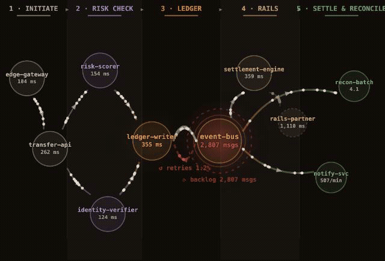
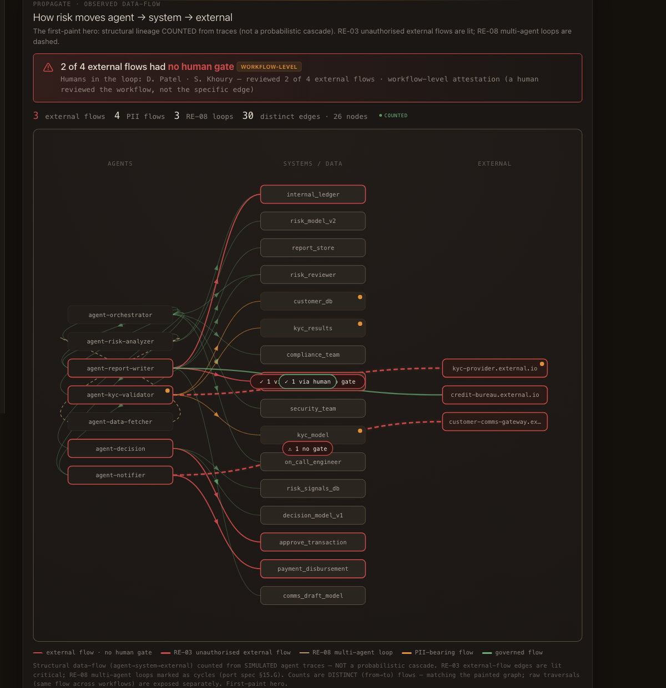
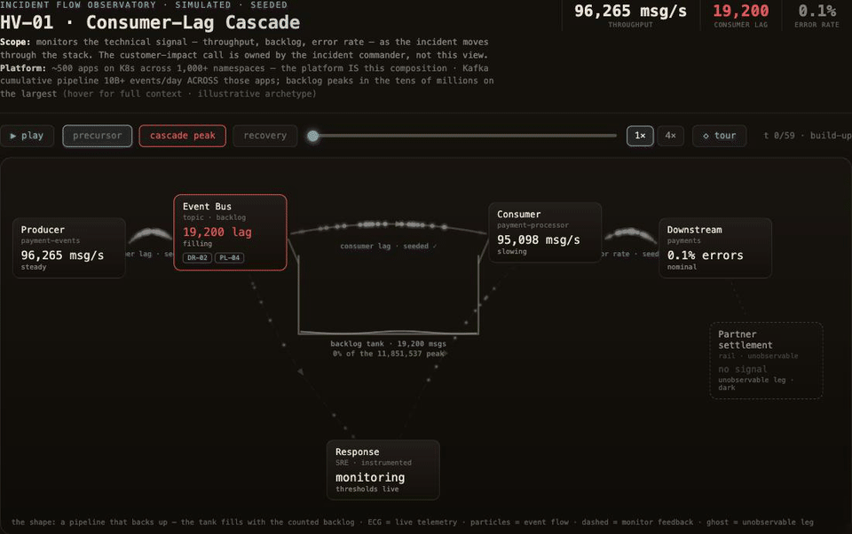
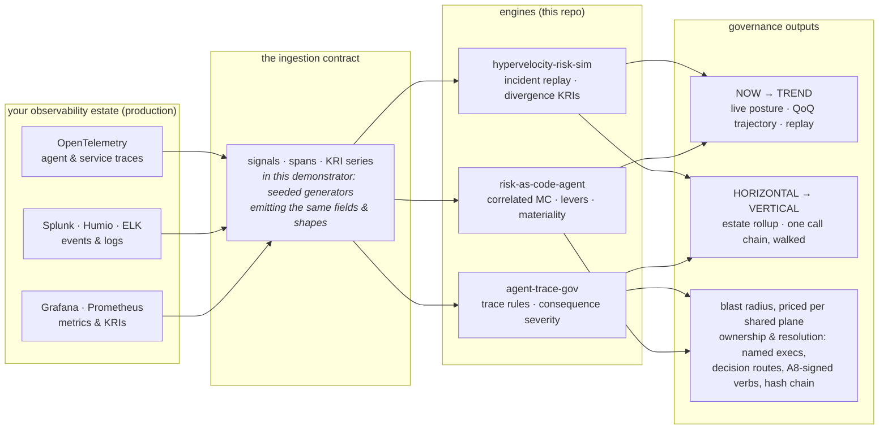
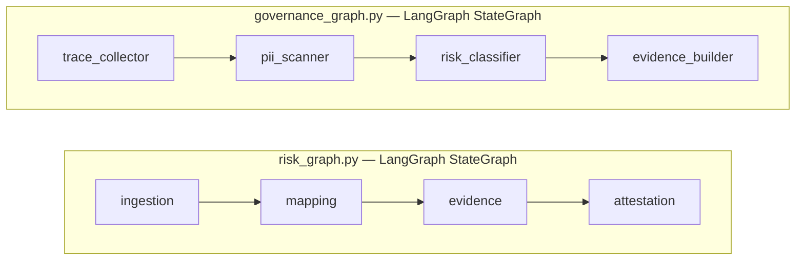

# agentic-risk-portfolio — risk-as-code, working end to end

In fintech and prediction markets, the business outruns engineering (new
products, new markets, new contracts by the hour), and engineering outruns
security and risk: deploys by the minute, billions of events, LLM agents in
production. Across hundreds of systems changing state every second, the
platform carries thousands of risks; the board sees a dozen, on a quarterly
slide. **So how would the board know every risk is identified and managed?
How would the risk owner know — today, not at the next quarterly review?**
Nobody can know by asking. Knowing has to be computed.

**Technology-risk oversight, run as software.** Three tools on one shared
platform price what a bad year costs, put AI agents on an evidence chain, and
replay incidents minute by minute. Every number on every page is generated
from seeded data, sealed, and re-checkable in your browser.

## See it in 60 seconds

**Open the live site: <https://jiten76.github.io/agentic-risk-portfolio/>**
No install, nothing to run.

Prefer it local? One command from a clone:

```bash
python3 -m http.server 8200
# then open  http://localhost:8200/PORTFOLIO_INDEX.html
```

The front door leads with the priced year. One click in, **the journey**: one
Instant Transfer money path (five stages, ten services, one seeded bad
morning) played live as an animated flow graph, with the risk chain (signals
→ risk IDs → owner → controls → explicit non-claims) under every hop. Posture
on the ribbon, verbatim: *2LoD independent observation — no findings, no
verdicts.*



What just played: the seeded bad morning. The event bus backs up, retries
climb, the backlog spills toward settlement, and every hop stays inside a
named owner's risk chain. That is the thesis in one screen: risk lives on the
edges of a money path, drawn in the same shape the payments team whiteboards.
It is also the shape the engines themselves run as (see "Why LangGraph" below).

## What this proves

### Risk quantification

A correlated Monte-Carlo turns 14 ways this platform can fail into one number
a board can argue with:

> **$98.1M residual P95** — a bad-but-plausible year, after controls —
> against **$246.3M inherent**, the same year with none.

- **Challenge it, don't trust it.** Every judgment I made is a lever you can
  re-run; the page shows how much each one moves the total.
- Bad years cluster, so the model prices failures getting worse together
  instead of assuming independence.
- Shared things fail together: an AWS region, the identity provider, etcd.
  A category-by-category risk list cannot see that loss. The dependency layer
  prices it.
- **It ends in a decision, not another chart.** The board brief turns the
  number into five asks a board can vote on, then the actual choice: harden
  the controls, remove the shared dependencies, or accept the risk and sign
  for it — each option priced from the same model, with named owners and
  honest delivery-risk flags.

### AI-agent governance

When AI agents do real work, someone has to catch them doing the wrong thing.
`agent-trace-gov` reads the execution traces agents leave behind and derives
**14 findings** — nothing is hand-labeled:

- **The catches:** an agent reaching a payments tool it was never authorized
  to touch · customer messages sent before any human approved them · a ledger
  write with no record of where the data came from · PII leaving the
  platform · consent gaps · two agents delegating to each other in a loop.
- Severity ranks by what the agent could actually do. An agent that can move
  money outranks a paperwork gap, and every rating shows its reasoning on the
  page with the regulations it touches (GDPR · EU AI Act · FINRA · SEA 17a-4 ·
  SOC 2 · NIST).
- Nothing happens without a named person, a written reason, and an expiry
  date. The log is tamper-evident and re-verifiable in the browser.
- The estate is mapped too: where data actually moved (agent → system →
  outside world, counted from the traces) and the shared services every agent
  stands on, each tied to a real public incident.

Below, the lineage graph as the workbench draws it: agents on the left,
systems and data in the middle, external endpoints on the right. Every edge is
counted from the traces; red marks an external flow that ran unauthorized.



The callout in the frame is counted off those edges, not asserted by a
reviewer: two of four external flows had no human gate. When the graph is
derived, the caption is a fact.

### Compliance automation / evidence-as-code

Every build also writes the risk catalog out as **OSCAL 1.1.2**, NIST's
machine-readable format for controls:

- **No retyping.** It's the format compliance platforms import directly, so
  the catalog lands in a GRC tool as data, not as somebody's weekend.
- Deterministic: same seed, same bytes, validating against NIST's own
  schemas.
- **Eleven regimes, mapped honestly.** The pages flag which rules a finding
  touches; the judgment call stays with Legal/Compliance.

### Detection economics

`hypervelocity-risk-sim` replays the same seeded incidents twice, side by
side — humans watching dashboards vs. fully instrumented:

- **Detection in ~2 minutes instead of 3–12**, by scenario (an illustration
  calibrated from practice, and labeled as such on the page), with the
  response timeline for both regimes.
- It doubles as a practice room: the same minutes a postmortem walks through,
  and a tabletop exercise can scrub back and forth.

Below: HV-01, the consumer-lag cascade. The producer holds steady near 96K
msg/s while the consumer stalls, so the backlog tank fills and the lag counter
runs from thousands into the millions; the moment chips walk precursor →
cascade peak → recovery.



Note what never happened: throughput stayed green for the entire incident;
watch levels alone and you sleep through the precursor. The divergence KRIs
are what fire,
and the instrumented response closes at audit-ready with the whole timeline
scrubbable for the postmortem.

## Two views, one spine

Most tools give you one altitude. Observability platforms walk a call chain
beautifully but price nothing; GRC registers roll risk up but connect to
nothing a service actually does. Here, both views hydrate from the same
sealed projection — and you can re-check that in your browser:

- **Horizontal — the ripple effect.** 14 failure patterns × 5 domains ×
  the shared dependency planes, one challengeable number, with the
  correlation story priced in: bad years cluster, and one failure ripples
  across everything that shares its dependencies. Breadth for the CRO:
  [open the workbench](https://jiten76.github.io/agentic-risk-portfolio/apps/risk-as-code-agent/docs/index.html#role=leadership).
- **Vertical drill-down — the API cascade chain.** The journey descends a
  single money path hop by hop with the risk chain under each service
  ([watch it](https://jiten76.github.io/agentic-risk-portfolio/apps/risk-as-code-agent/docs/journey.html));
  agent-trace-gov walks one workflow span by span to the finding it produced
  ([walk it](https://jiten76.github.io/agentic-risk-portfolio/apps/agent-trace-gov/docs/index.html));
  the observatory follows a cascade through the stack minute by minute
  ([scrub it](https://jiten76.github.io/agentic-risk-portfolio/apps/hypervelocity-risk-sim/docs/index.html)).
  Depth for the incident reviewer.
- **Same data, both altitudes.** The board's number and the engineer's hop
  come from one projection, so breadth and depth cannot drift apart.
  [Re-check the seal](https://jiten76.github.io/agentic-risk-portfolio/apps/risk-as-code-agent/docs/validation.html).

And the pivot runs both ways in the pixels: register rows whose pattern rides
the money path link straight to its chain ("on the money path ↗"), and every
incident cascade names the register pattern it replays ("priced as RP-… ↗"); the mapping is
hand-reviewed and machine-gated on both sides. The honest boundary that
remains: one money path and four cascades exist as verticals so far, and a
pattern without a vertical simply gets no door.

## The two questions readers ask first

**"How are you doing this for agentic workflows?"**

Every agent action leaves a trace: which agent, what action, what target,
what data classes, whether a consent record or human gate was present, at
what confidence. `agent-trace-gov` runs deterministic rules over those
fields (the same fields an OpenTelemetry pipeline already exports) and
derives findings from what the trace proves: an out-of-scope tool call, an
external send before any human approved it, a write with no lineage. No LLM
judges anything at runtime; the classifier is a LangGraph state machine you
can read in
[governance_graph.py](apps/agent-trace-gov/graph/governance_graph.py),
severity ranks by what the agent could actually *do*, and the
misbehavior-injection eval in "How I know it holds up" below grades those
rules against traces they were never built against. Watch it work:
[the atg workbench](https://jiten76.github.io/agentic-risk-portfolio/apps/agent-trace-gov/docs/index.html).

**"How are you doing risk quantification — what data, and from where?"**

Four source layers, each honestly labeled. **Published standards** anchor the
thresholds (NIST, DORA, CISA KEV), flagged *source-derived* or
*operator-calibrated* in the pixels. **Internal registers** supply the
governance context the way a real second line holds it: an internal-audit
register with past-due repeat issues, risk acceptances carrying owners and
expiry dates, delivery-risk flags, and committee decision routes: the
politics, captured as data. **Operational telemetry** drives
posture: KRI series and journey signals crossing their thresholds into
red / amber / green, so the register's state comes from which thresholds
fired, not from a workshop vote. **The model** then prices it: a correlated
Monte-Carlo over frequency × severity, failures that trigger each other,
shared dependencies that fail together, every judgment a re-runnable lever.
In this demonstrator every layer is seeded (seed 42, byte-reproducible),
with structure from production second-line practice and every name, value,
and date synthetic, because a stranger has to be able to re-check all of it. In
production, the telemetry layers are the exports your estate already produces
(Grafana, Splunk, OTel); integration is exporter configuration, and the
honest boundary is that no adapter ships here. The examiner's version, with
every threshold's provenance:
[the validation annex](https://jiten76.github.io/agentic-risk-portfolio/apps/risk-as-code-agent/docs/validation.html).

## How I know it holds up

I built these, then put them through a recorded adversarial-review history:
independent AI reviewers (Grok and fresh Claude sessions, no shared context)
plus my own role-played 2LoD officer, examiner, SRE, and CISO agents. **These
are AI reviews, not human sign-offs.** The artifacts disclose that in the
pixels. Every real
finding is fixed and then machine-gated so its class stays fixed:

- **234 substance-audit gates** across the three tools (123 · 76 · 35) plus 26
  bundle-level gates: each asserts behaviour, not existence, and fails the build loudly
  (this sentence is itself build-gated against the machine-written trust board)
- a **gate-falsification harness**: planted defects must be *caught* before any release cut
- a **detection-efficacy eval** on the agent governor: 28 injected misbehaviors
  it was never built against. 18/18 in-class variants caught, 10/10 near-misses
  cleanly rejected, 0 false fires, the uncovered class named in the record.
  The loop closes through a human (A8), never by self-tuning
  (these figures are build-gated against `qa/detection_eval.json`)
- **byte-reproducible builds** (seed 42) with an in-browser SHA-256 seal anyone can re-run
- **conservation manifests** proving each redesign lost nothing, and a defect-class
  ledger recording every bug class alongside the gate that now guards it

The full adversarial method (the review brief, the defect ledger, the attack
vectors handed to each reviewer) is its own exhibit:
[PORTFOLIO_REVIEW_BRIEF.md](PORTFOLIO_REVIEW_BRIEF.md).

## Architecture — built to sit on your telemetry, demonstrated on seeded streams



The engines in the middle box are themselves graphs — LangGraph state
machines, drawn and machine-gated against their source in "Why LangGraph"
below.

**The design premise:** everything here consumes telemetry your estate already
emits. The agent classifier's rules run over OpenTelemetry-shaped spans (the
same fields Grafana Tempo, Splunk, or an ELK pipeline exports) and say so in
the classifier's own docstring; the KRI series are the divergence-form signals a Prometheus
scrape already carries. **This demonstrator seeds those streams synthetically
(seed 42, byte-reproducible) so every claim is re-checkable; production
integration is exporter configuration, not re-architecture.** No adapter code
ships here; that is the honest boundary of the claim.

**What the engines then give a risk organization, on four axes:**

- **Now → trend.** The workbench prices posture as of this run; the
  trajectory view holds the quarter-over-quarter series with a forecast; the
  observatory replays any incident minute by minute. Same sealed data, three
  time scales.
- **Horizontal → vertical.** The estate rolled up, then one chain walked —
  the pairing argued in "Two views, one spine" above.
- **Blast radius.** The dependency layers price what each shared plane
  (identity, cloud region, K8s control plane, model provider, MCP registry…)
  contributes to the tail: named, priced concentration, with the analogs
  mapped between infrastructure and agent estate.
- **Ownership & resolution.** Findings carry named accountable executives,
  committee decision routes, competing commitments, and past-due flags from
  the internal-audit register; actions require a named human with a
  justification and expiry (A8), hash-chained into an attestation log, so
  risk has a named owner and every decision leaves evidence.

The hub is a **contract platform**, not a runtime bus: spokes import its
packages (render-from-data runtime, canonical KRI catalog + crosswalk,
OSCAL 1.1.2 bindings, signed agent identity cards) and conform to its
contracts. `ui-system` was extracted from the working spokes, not speculated
up front. Each spoke ships a self-contained dashboard under
`apps/<spoke>/docs/`: static files, no server. Built end to end on an
AI-agent toolchain (Claude Code), adversarially reviewed, with the review
history in the open.

- **`risk-as-code-agent`** — the priced engine: 14 risk patterns, thresholds
  anchored to published standards (NIST, DORA, CISA/KEV) and flagged
  `source_derived` vs `operator_calibrated`; inherent → controls → residual
  with a correlated Monte-Carlo; regulatory materiality; the journey, the
  printable board brief ending on a strategy decision surface, and an
  examiner validation package.
- **`agent-trace-gov`** — runtime trace governance: verdict-free findings
  derived from trace rules, **consequence-derived severity with its basis in
  the pixels**, counted lineage, human-in-the-loop gates, attestation chain.
- **`hypervelocity-risk-sim`** — the incident observatory: **four failure
  shapes** as animated flow graphs over a scrubbable timeline, manual vs
  instrumented, response-gap figures labeled as operator-calibrated
  illustration.

### Why LangGraph

**The choice.** An agent workflow is already a graph of tool calls. A pipeline
that governs agents should speak the same idiom (explicit nodes, explicit
edges, one shared typed state, no hidden control flow), so the governor is
inspectable the same way the governed is.

**What we wanted.** Stages a reviewer can point at, evidence capturable at
every hop, and runs that reproduce byte-identically under the seed.

**How.** Two four-node state machines:
[risk_graph.py](apps/risk-as-code-agent/graph/risk_graph.py) assembles the
priced register, [governance_graph.py](apps/agent-trace-gov/graph/governance_graph.py)
derives findings from the agent traces. Each node is one stage over the shared
state; determinism is not assumed: an audit gate re-runs the full pipeline
and diffs the register to prove it.

**The reward.** A new rule lands as a new node without touching its neighbors,
and the pipeline's own execution is part of the evidence trail. The diagram
below is machine-gated against the `add_node` registrations in the source,
both directions: the picture cannot drift from the code. The surfaces above
(the journey, the lineage, the observatory) render the same shape the engines
run: stages as nodes, risk on the edges.



## Skills in evidence

Monte Carlo risk quantification · operational & technology risk · model-risk
discipline (SR 11-7-style challenge, sensitivity, counterfactuals) · 2LoD /
three-lines governance · AI agent governance & LLM tracing · graph-orchestrated
pipelines (LangGraph) · OSCAL · NIST 800-53
& CSF 2.0 · DORA / NYDFS 500 / FFIEC mapping · continuous control monitoring ·
evidence-as-code · hash-chained audit trails · Kubernetes & streaming reliability
patterns · Python · deterministic, seal-verified builds · adversarial self-review

## Run a spoke

```bash
cd apps/risk-as-code-agent
python -m venv .venv && .venv/bin/pip install -r requirements.txt
# then generate the dashboard — see the spoke's own README for the one-liner
```

A spoke resolves the hub at `../../packages/ui-system` — no install; the monorepo
layout makes the hub a sibling. To add a spoke: emit a projection, the hub renders
it, conform to the taxonomy/OSCAL contracts as they land.

## Status

Public and live. The site above serves the current sealed build; this repo is
the release snapshot — a single-commit history by design, with the full
development history retained in the private platform repo. Three tools, one
landing page, one playable journey, and three workbenches, with the board
brief and the examiner validation package as printable annexes. Every build
is audited, sealed, and reproducible.

## License

See [LICENSE](LICENSE).

## Author

**[Jitendraa Joshii](https://linkedin.com/in/jitendraa-joshii-0b8ba51)** — risk &
security practitioner; the structure here is built from production second-line
practice at US fintechs. Every name, value, and date is synthetic; employer
specifics stay at work. Built solo, end to end, with an AI-agent toolchain, then
reviewed adversarially the same way (disclosed as such).
